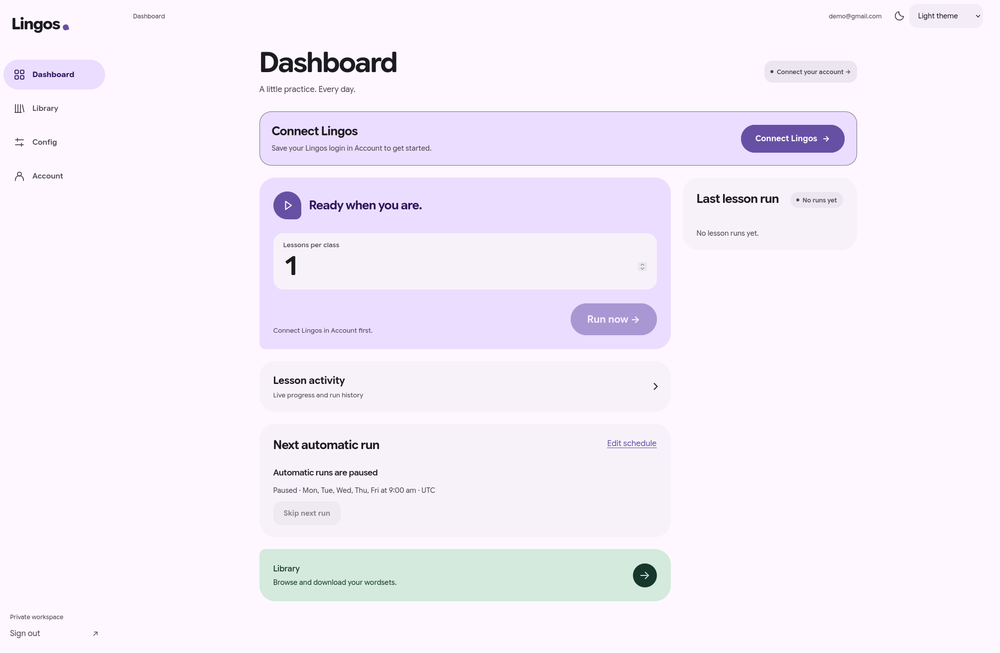
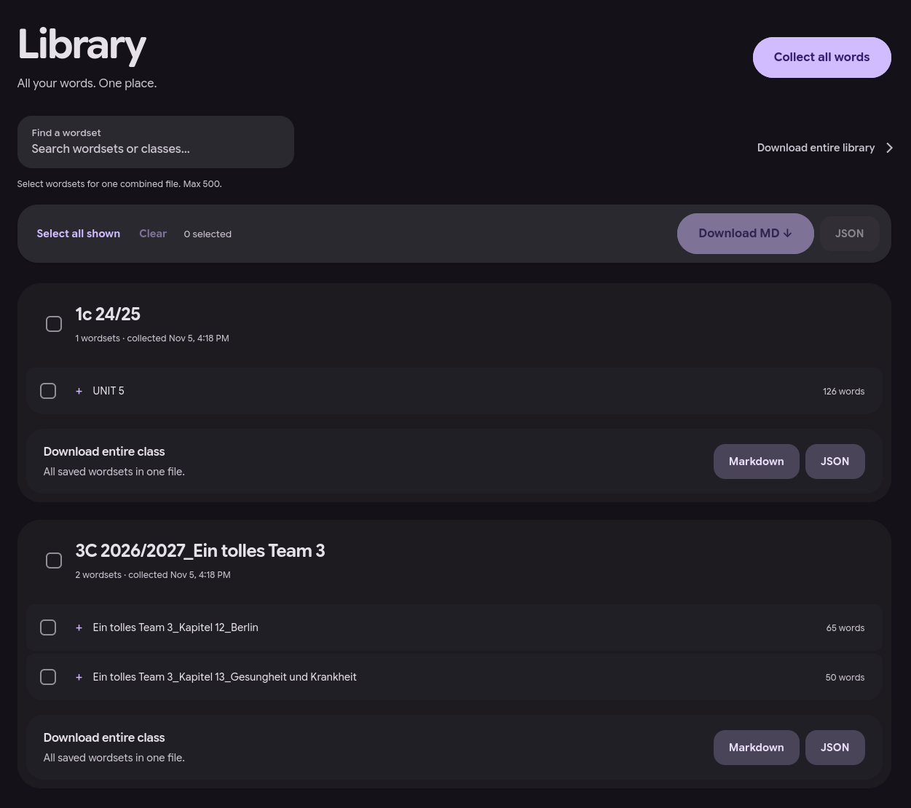
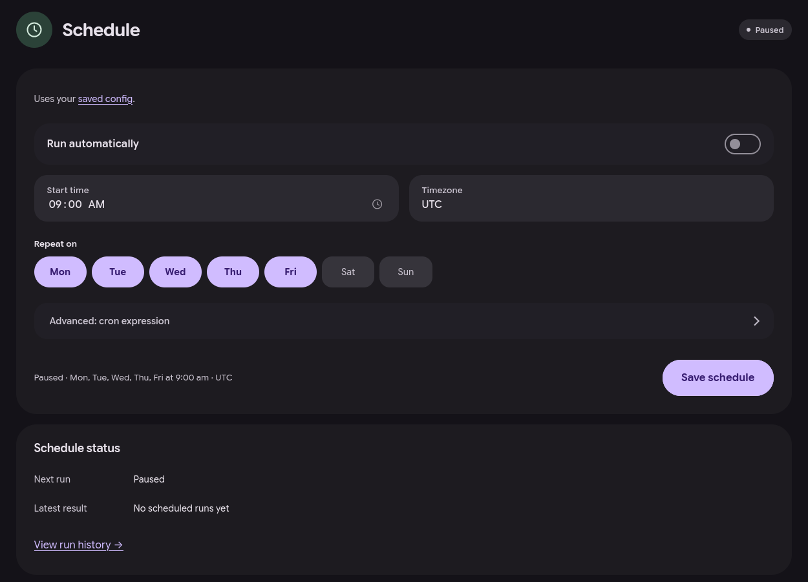
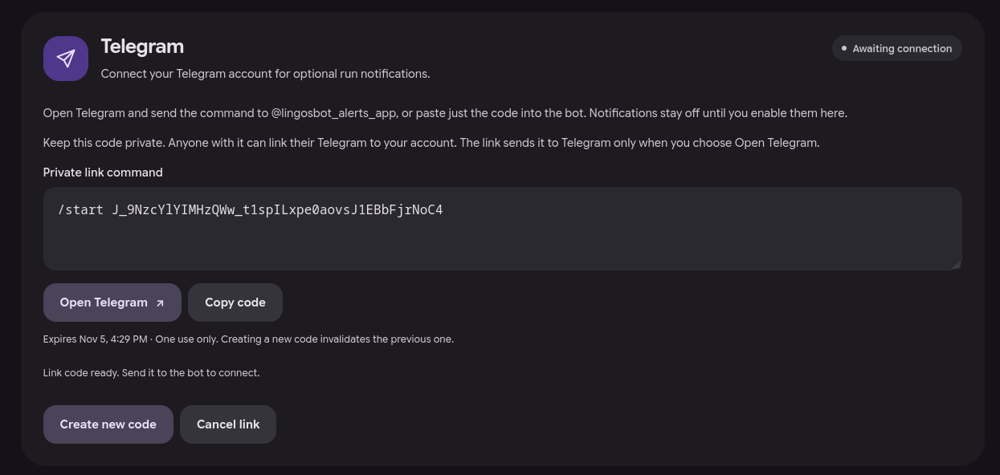
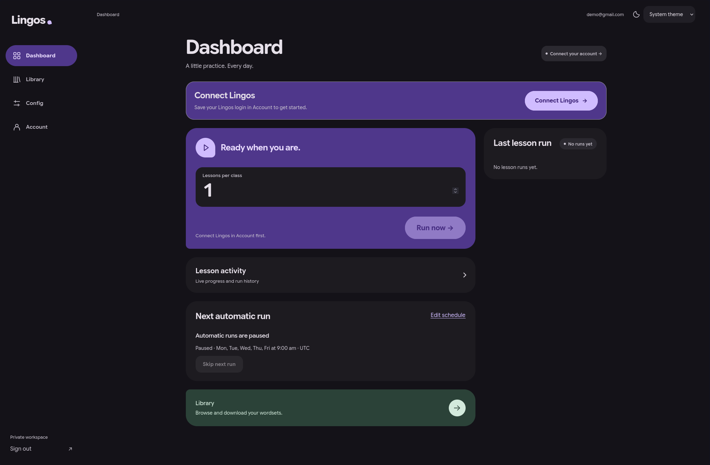

# WebUI: Getting Started

The WebUI is a website where you control LingosBot. You sign in, save your Lingos login, pick how many lessons to do, and press a button. It can also run lessons on a schedule, collect your vocabulary into a library and send results to Telegram. Each person gets a private workspace that other users cannot see.



## Part A: I got an account / want to sign up

### 1. Sign in

1. Open the address your administrator gave you (for example <http://127.0.0.1:8080>).
2. Type your **email** and **password**, then press **Sign in**.
3. To change your password later, open **Account → Workspace password**.

### 2. No account yet? Sign up

What you can do on the sign-in page depends on how the administrator set it up:

| Mode | What you see | What happens |
|------|--------------|--------------|
| Admin-created accounts (default) | "Accounts are created by your administrator." | You cannot sign up yourself. Ask the administrator for an account. |
| Approval required | **Create an account** link, then **Request access** | You send a request. You can sign in only **after an administrator approves it**. |
| Open registration | **Create an account** link, then **Create account** | Your account works right away. |

1. On the sign-in page, click **Create an account** (or open `/#register`).
2. Enter your email and a password of **at least 12 characters**, twice.
3. Press **Request access** or **Create account**.

### 3. Save your Lingos login

Your workspace password and your Lingos password are two different things.

1. Open **Account → Lingos credentials**.
2. Enter your **Lingos email** (not a username) and **Lingos password**.
3. Press **Save credentials**.
4. Press **Verify credentials** to check that the login works. This also loads your classes. No lessons are started. Your Lingos password is stored encrypted and is never shown again.

### 4. Choose lessons and classes

1. Open **Config → Lesson defaults**.
2. Set **Default lessons per class** (how many lessons per class each run does).
3. Under **Lessons per class**, press **Sync classes** to load your classes. For each class you can type a number, leave it blank to use the default, or type **0** to skip that class.
4. Press **Save config**.

### 5. Start a run and watch it

1. Open **Dashboard**.
2. Check **Lessons per class** and press **Run now**. This number applies only to this run.
3. Watch progress under **Lesson activity**. You can close the tab; the run keeps going. Come back later to see it.
4. To stop, press **Stop run**. Lessons that are already finished stay finished.
5. **Last lesson run** shows the result of your latest run.

### 6. Your vocabulary library

1. Open **Library** and press **Collect all words**. This gathers the words from all your classes without doing any lessons.
2. Use **Find a wordset** to search.
3. Tick the wordsets you want (up to 500), or use **Select all shown**.
4. Press **Download MD** for a Markdown file or **JSON** for a JSON file. You get one combined file.
5. To download everything, open **Download entire library** and choose **Markdown** or **JSON**.



### 7. Set a schedule

1. Open **Config → Schedule** (or **Edit schedule** on the Dashboard).
2. Turn on **Run automatically**.
3. Pick a **Start time**, a **Timezone** (for example `Europe/Warsaw`) and the days under **Repeat on**.
4. Press **Save schedule**.
5. Need to skip one day? On the Dashboard, press **Skip next run**. Later runs stay on. The server has to be running at the scheduled time.



### 8. Telegram notifications (optional)

This works only if the administrator has turned on the Telegram bot.

1. Open **Account → Telegram** and press **Create link code**.
2. Press **Open Telegram**, then press **Start** in the bot chat. (Or copy the code and send it to the bot.)
3. Back in the WebUI, turn on **Lesson run notifications**. They are off until you do this.
4. To stop, press **Disconnect**, or send `/stop` to the bot.

You only get a short result after lesson runs finish. The bot cannot start or stop lessons.



### 9. Light or dark theme

Click the moon/sun button in the top corner. The page follows your device setting until you pick a theme yourself. Your choice is saved in this browser only.



## Part B: I want to host it

The easiest way is Docker Compose. You need [Docker](https://docs.docker.com/get-docker/) and a copy of this repository.

1. Generate an encryption key **once**:

   ```sh
   openssl rand -base64 32
   ```

2. Create the file `docker-webui/.env` (never commit it):

   ```sh
   ADMIN_USER=admin@example.com
   ADMIN_PASSWORD=choose-a-long-unique-password
   ENCRYPTION_KEY=paste-the-key-from-step-1
   COOKIE_SECURE=0
   ```

   Use `COOKIE_SECURE=0` only when you open the site at `http://127.0.0.1`. Behind HTTPS, use `1`.

3. From the repository root, start it:

   ```sh
   docker compose -f docker-webui/docker-compose.yml up --build
   ```

4. Open <http://127.0.0.1:8080> and sign in with `ADMIN_USER` and `ADMIN_PASSWORD`.
5. Create accounts in **Users**, or choose a registration mode in **Workspace registration** on the Dashboard. Approve requests in **Users**.

> [!WARNING]
> Generate `ENCRYPTION_KEY` **once** and keep it somewhere safe. Use the same key after every update and restart. If you lose it or change it, every saved Lingos password becomes unreadable and all users must enter them again.

## Common problems

- **"Sign-in failed."** Check the email and password. If you just requested an account, an administrator must approve it first.
- **No "Create an account" link.** Registration is set to admin-created accounts. Ask the administrator.
- **Signing in shows `{"error":"forbidden"}` or you are not kept signed in.** `COOKIE_SECURE=1` (the Compose default) is set while you use plain `http://`. Set `COOKIE_SECURE=0` for local HTTP, or use HTTPS.
- **The server will not start: "ENCRYPTION_KEY must be base64 for exactly 32 bytes".** Generate it with `openssl rand -base64 32` and paste it whole.
- **Telegram says "Not enabled".** The administrator has not set `TELEGRAM_BOT_TOKEN`.
- **A run says "interrupted".** The server restarted during the run. Check Lingos before you run again.
- **A scheduled run did not happen.** The server must be on at that time. After downtime, one missed run starts as soon as possible.

---

Running without Docker, every environment variable, security model and tests → [Technical reference](reference.md)
