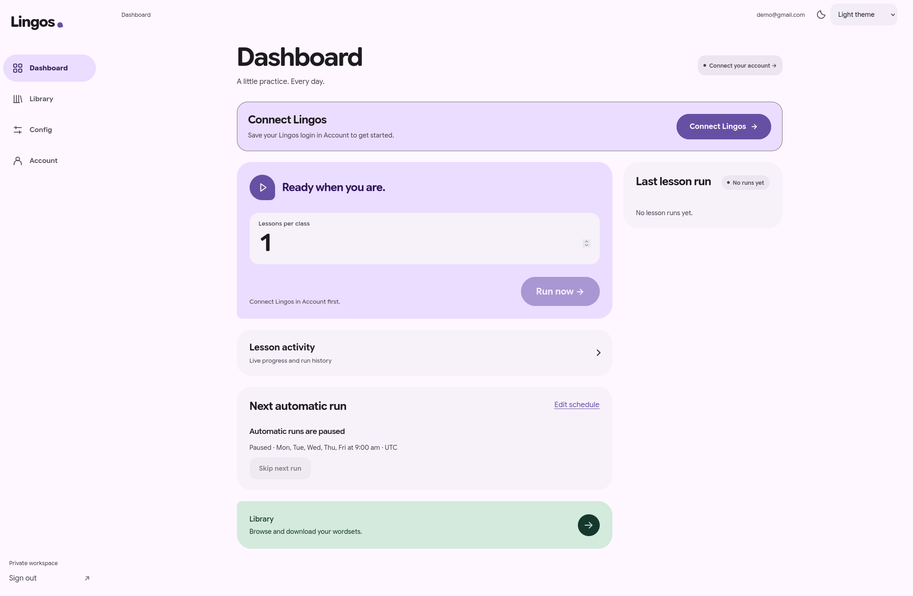
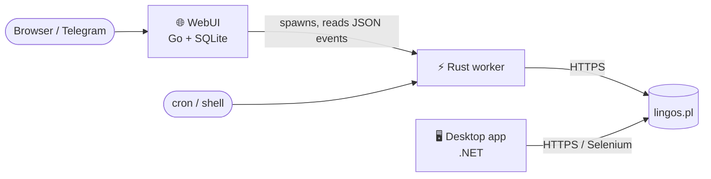
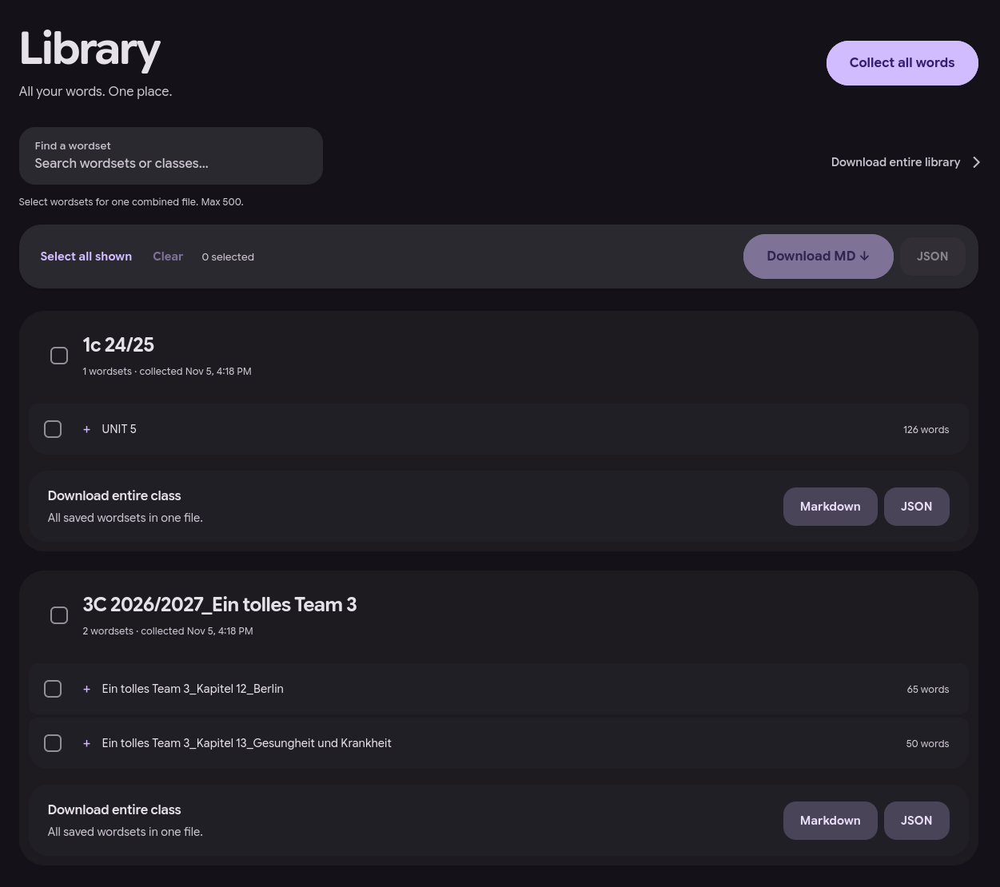
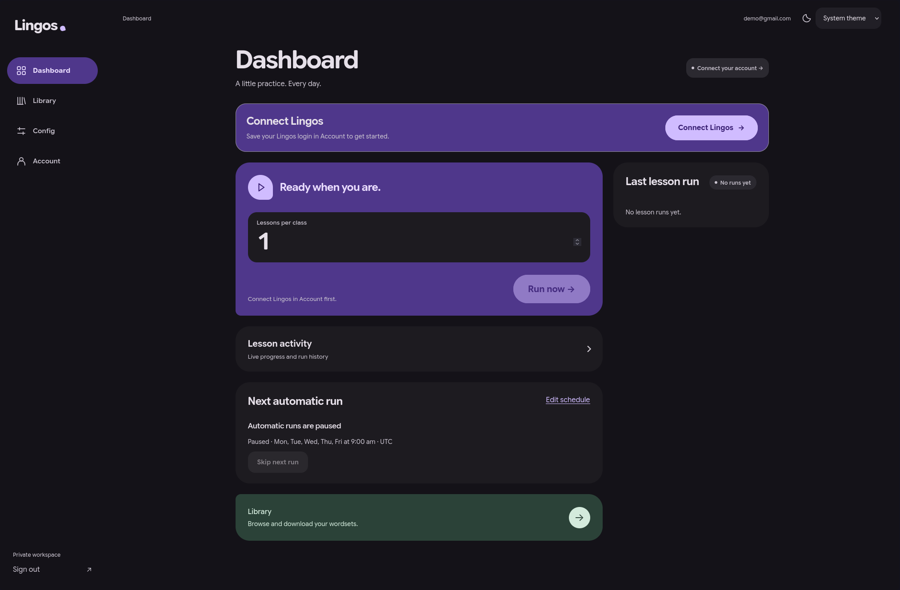
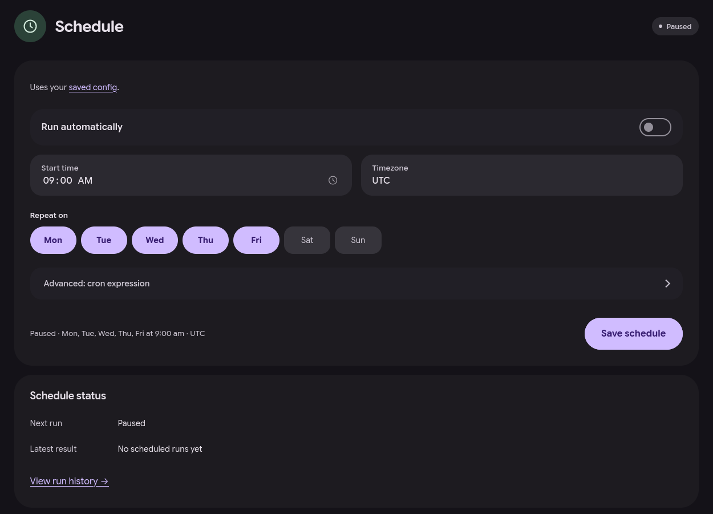
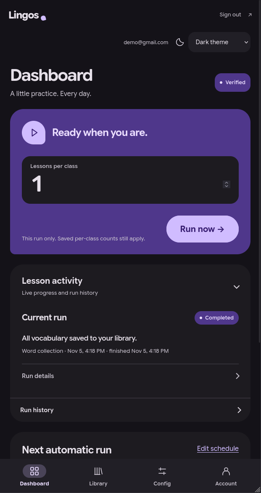

<div align="center">


# LingosBot

**Automates vocabulary lessons on [lingos.pl](https://lingos.pl/): sign in, collect the class vocabulary, finish lessons and challenges.**

[](https://github.com/blestafist/LingosBot/releases/latest)
[](https://github.com/blestafist/LingosBot/actions/workflows/ci-release.yml)


[Quick start](#quick-start) · [Components](#components) · [Documentation](Docs/README.md) · [Releases](https://github.com/blestafist/LingosBot/releases) · [Issues](https://github.com/blestafist/LingosBot/issues)

</div>

<p align="center">
  
</p>

> [!WARNING]
> Automation may conflict with the lingos.pl terms of service. Use LingosBot only with an account you are allowed to automate, at your own risk.

## Components

|  | Component | What it is | Best for |
| --- | --- | --- | --- |
| 🌐 | **[WebUI](Docs/webui/README.md)** (Go) | Multiuser web panel: live run progress, per-user schedules, Telegram notifications, vocabulary export to Markdown/JSON, admin-approved registration. | A shared server for you, friends or a class |
| ⚡ | **[Rust worker](Docs/worker/README.md)** | Standalone static Linux CLI (~3 MB, ~5 MB peak RSS). Pure HTTP, no browser, .NET or database. ~0.17 s per word. | Cron jobs, headless servers, powering the WebUI |
| 🖥 | **[Desktop app](Docs/desktop/README.md)** (.NET, legacy) | Console app for Windows, macOS and Linux with API mode and an optional Selenium browser workflow. | Running locally on your PC |



## Quick start

> [!TIP]
> Every component has a 🟢 **Getting started** guide in plain language and a 🔧 **Technical reference** for every flag and internal. See the [documentation index](Docs/README.md).

All binaries are published together in each [`v*` release](https://github.com/blestafist/LingosBot/releases): desktop ZIP archives, static Linux worker binaries and Linux WebUI binaries (x64 and arm64), each with a `.sha256`.

**WebUI** — download `lingosbot-webui-linux-<arch>` and `lingosbot-worker-linux-<arch>`, then follow the [WebUI guide](Docs/webui/README.md). Docker Compose is supported too.

**Rust worker** — one binary, configured with a JSON file:

```bash
./lingosbot-worker-linux-x64 --help
```

See the [worker guide](Docs/worker/README.md) for configuration, safe credential input and the JSON/exit-code contract.

**Desktop** — download the ZIP for your OS, extract it and follow [Basic setup](Docs/desktop/basic.md).

## Screenshots

<table>
  <tr>
    <td width="50%"></td>
    <td width="50%"></td>
  </tr>
  <tr>
    <td align="center">Vocabulary library with Markdown/JSON export</td>
    <td align="center">Dark theme</td>
  </tr>
  <tr>
    <td></td>
    <td align="center"></td>
  </tr>
  <tr>
    <td align="center">Per-user schedules</td>
    <td align="center">Phone layout</td>
  </tr>
</table>

## Build from source

```bash
cargo build --locked --release --manifest-path worker-server-rust/Cargo.toml   # Rust worker
(cd docker-webui && go build .)                                                # WebUI
dotnet build worker-desktop                                                    # Desktop app
```

Toolchains, tests and the release process are described in [Development](Docs/README.md#development).

## Repository layout

```text
docker-webui/         Go WebUI, Dockerfile and Compose file
worker-server-rust/   Rust HTTP worker
worker-desktop/       .NET desktop app (legacy)
deploy/               Release download helper
Docs/                 Documentation, release notes and screenshots
```

## Support

Report bugs and suggestions through the [issue tracker](https://github.com/blestafist/LingosBot/issues). Before attaching diagnostics, read [Diagnostics and privacy](Docs/desktop/README.md#diagnostics-and-privacy): they may contain account data.
